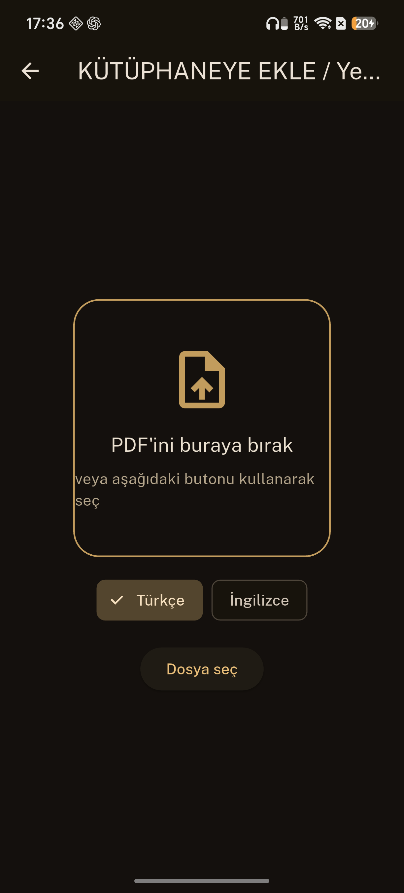
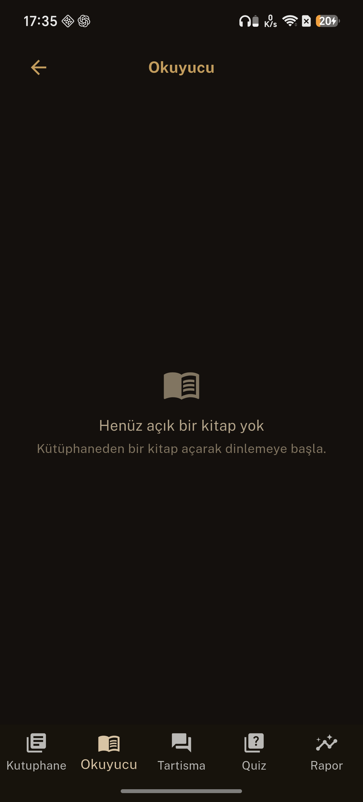
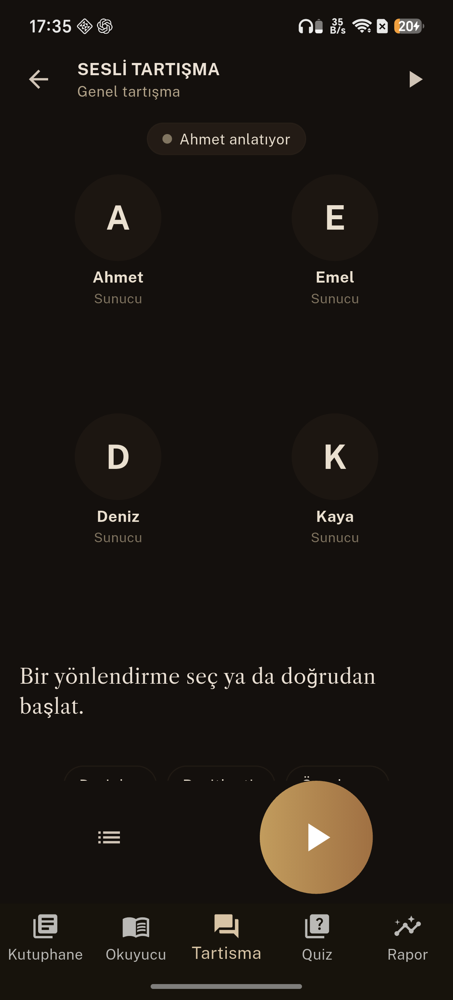
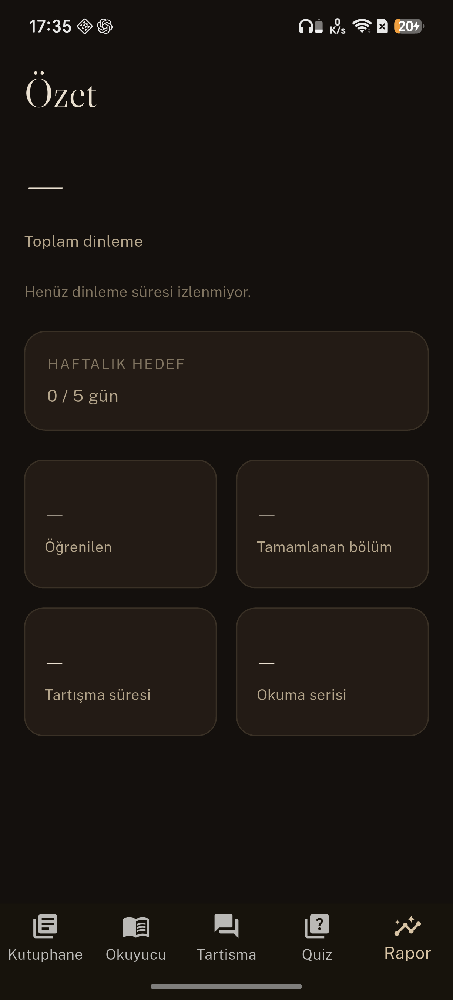
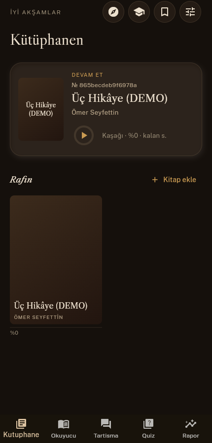
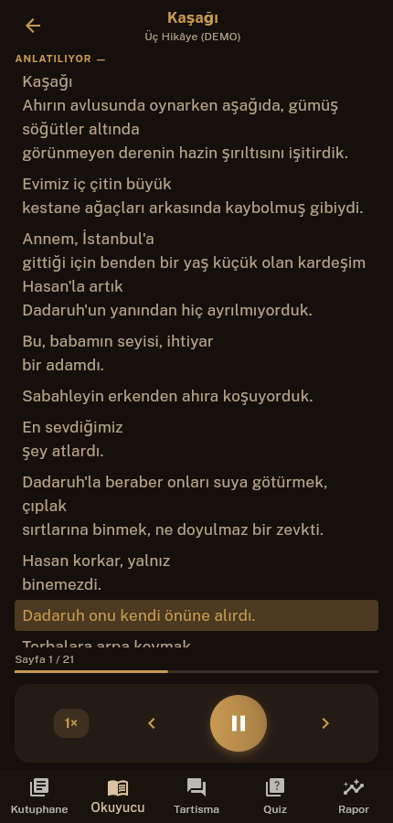
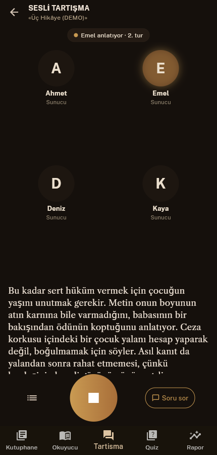
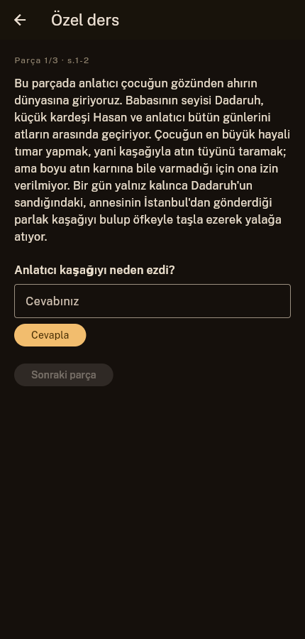

# PDF Audiobook (Sesli Kitap)

**An alternative to subscription audiobook apps such as Storytel and Audible: instead of waiting for a book to
appear in someone's catalogue, turn any PDF you own into an audiobook.** The app cleans the PDF text, reads it aloud
sentence by sentence with the sentence highlighted, and then lets you discuss the book with AI by voice, take quizzes
and get a private lesson on what you read. No subscription and no server of its own: you bring your own AI key, or
use the key-free default voice.

Built with Flutter (Android target; Linux/Windows desktop folders are included). Turkish and English books are supported.
The app UI is Turkish today because it was built for Turkish PDFs; an English UI is planned. Source code comments are
partly Turkish.

| | Subscription audiobook apps | PDF Audiobook |
|---|---|---|
| Which books | the service's catalogue | any PDF you have |
| Narration | recorded by a narrator | text-to-speech (Edge default, Google or Gemini voices) |
| Cost | monthly subscription | no subscription; AI and some voices use your own API key |
| After listening | — | voice discussion, quizzes, private lesson on the chapter |

## Features

| Feature | In short |
|---|---|
| Reader | Cleans the PDF page (OCR errors, hyphens, running headers), reads it aloud sentence by sentence and highlights the sentence being read. |
| Ask | Long-press a sentence while reading: a Turkish explanation of the word or sentence. |
| Voice discussion | Four hosts (Ahmet, Emel, Deniz, Kaya) discuss the topic based on the book text; you can jump in with questions. |
| Quiz | Four-option questions from the chapters you read; wrong answers go to review cards. |
| Private lesson | Splits a chapter into parts and teaches it like a lesson; progress is saved on the device and resumes where you left off. |
| Summary | Total listening time, weekly goal, reading streak. |

## AI and speech providers

Chosen in the Settings screen:

- **Text/LLM:** Google (Gemini), DeepSeek, NVIDIA or "all" (providers with a key are tried in order).
- **Speech:** Edge (no key, default), Google (Cloud TTS) or Gemini TTS (discussion voices). Settings also lists "Azure", but key entry is not implemented yet; choosing Azure without a key falls back to Edge.

Keys are stored only on the device; the app talks to the provider directly, with no server of its own.
The repository contains no keys; you enter your own key inside the app.

## Screens

| Add book | Reader | Voice discussion | Summary |
|---|---|---|---|
|  |  |  |  |

## How it works

```
PDF → page text (+ OCR) → pre-clean → LLM clean-up (auditor if suspicious) → split into sentences → TTS → play + highlight
                                   └── discussion / quiz / lesson / ask: same LLM layer (lib/io/llm_client.dart)
```

- `lib/src/` pure logic (state machines, splitting, prompts, provider selection).
- `lib/io/` network and files (LLM, TTS, PDF, cache).
- `lib/ui/` screens.
- `test/` unit and widget tests; `integration_test/` end-to-end smoke tests (against a fake server, no live API needed).

## Requirements

- Flutter 3.35.7 (Dart 3.9.2); CI uses the same version.
- An Android device/emulator to run the real app; the demo and tests need no device (Linux desktop).
- For end-to-end Linux mode: `xvfb` and the packages in `scripts/e2e-apt.txt` (optional).

## Run with one command

Key-free trial: **`make demo`** (= `bash scripts/demo.sh`, entry point `lib/main_demo.dart`).
The demo opens WITHOUT an API key, with a ready sample book; AI answers and audio are **FAKE**.

```bash
make demo                      # desktop window (Linux: -d linux; for Windows/macOS DEMO_DEVICE=windows|macos)
make demo-shot                 # headless (xvfb): build + open + PNG -> docs/demo/acilis.png (startup proof)
make demo-test                 # test/demo + end-to-end demo flow (no device)
make demo-smoke                # the smoke test CI runs: tests + startup PNG + full demo flow (~3 min; measured on a real runner: 3:16)
```

**Requirements (Linux desktop, verified path)**

- Flutter 3.35.7 (Dart 3.9.2), `flutter` on PATH.
- Build tools: `libgtk-3-dev clang cmake ninja-build pkg-config` (full list: `scripts/e2e-apt.txt`;
  `bash scripts/e2e-apt-install.sh` installs what is missing).
- For headless runs (`demo-shot`, `demo-smoke`) also `xvfb` and ImageMagick (`imagemagick`);
  optionally `xdotool` to crop screenshots to phone proportions.
- On Windows/macOS the same command runs with `-d windows` / `-d macos`; those paths were not tested here.

**What is fake in the demo?**

| Real | Fake |
|---|---|
| All screens, PDF text extraction, the reading pipeline, discussion/quiz/lesson logic, progress saving | LLM answers: pre-written Turkish discussion, quiz, lesson, question bank and "Ask" explanations (no model is called) |
| The app's own HTTP/TTS client code | Server: in-process loopback; audio is **silent** (duration follows text length, the karaoke highlight advances on a timer) |

Sample book: **Ömer Seyfettin, "Üç Hikâye"** (Kaşağı, Forsa, Primo Türk Çocuğu; 21 pages). The author died in 1920,
so the work is in the public domain. Text: Wikisource (tr.wikisource.org). Attribution and details: `assets/demo/KAYNAK.txt`.

| Library | Reader (p.1, playing) | Voice discussion | Private lesson |
|---|---|---|---|
|  |  |  |  |

Desktop startup screenshot (`make demo-shot`): `docs/demo/acilis.png`.

## Demo mode

- The demo (`make demo`, entry point `lib/main_demo.dart`) runs on mock data WITHOUT an API key: a sample book (public domain), fake LLM answers (cleaner, discussion, lesson) and fake/silent audio. In the demo entry point every HTTP request is routed to an in-process loopback fake server; settings live in memory and are not written to disk. So in the demo no request reaches a real provider and any key you type is not kept.
  (The demo book and audio cache are written to the system temp folder, `sesli_kitap_demo_*`; they are deleted on Ctrl+C / close signal, but may remain after a hard kill.)
- To try with a real key, run the standard app, NOT the demo entry point (`flutter run -d linux`, entry point `lib/main.dart`), and enter your own key in Settings > ACCOUNT & API.
- In the standard app the key is stored only on your device; the developer/project has no server. The key goes over HTTPS only to the provider you choose, as a request HEADER (never in the URL): for LLM, Gemini / DeepSeek / NVIDIA (`Authorization: Bearer`; endpoints: generativelanguage.googleapis.com, api.deepseek.com, integrate.api.nvidia.com); for speech, Google Cloud TTS (`X-Goog-Api-Key`) or Gemini TTS (`x-goog-api-key`) if selected, to the matching Google endpoint. The request body also carries the text of the book pages you read to these providers. The key-free default speech provider (Edge TTS) sends the text to Microsoft's read-aloud service over WebSocket.
- WARNING: keys are currently stored on the device UNENCRYPTED, as plain text in `SharedPreferences` (key names: geminiKey, deepseekApiKey, nvidiaApiKey, googleKey).

## Known limits / roadmap

- Secure key storage for the store release is planned (flutter_secure_storage / Android Keystore); not implemented yet.
- Release signing is planned (upload keystore; the keystore and passwords will be CI secrets, never in the repo). Today the release build is signed with the debug key (android/app/build.gradle.kts), so it cannot be uploaded to the store.
- The demo is verified on Linux desktop; there is no web target (persistence/audio rely on dart:io). just_audio has no Linux plugin, so demo audio is fake/silent.


## Development

```bash
flutter pub get
flutter analyze
flutter test
make e2e          # end-to-end smoke tests (no device)
```

`.github/workflows/ci.yml` runs parallel jobs on every push and pull request (~2 min total): `analyze`,
a three-shard `test (0/3..2/3)`, `smoke-shot` (the demo opens under xvfb, startup screenshot) and
`smoke-e2e` (the whole demo flow with fake answers); `ci-ok` is the summary gate that waits for all of them to be green.
